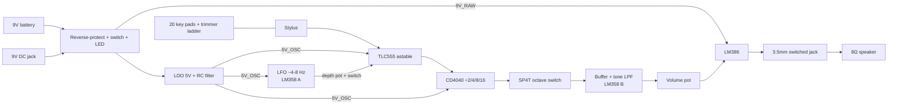

# Stylus Synth: Project Plan

Working name: **StyloSynth-555**. This is an original design inspired by the TouchTone555
(darcyjprojects.xyz), which is itself inspired by the vintage Stylophone. None of the reference's
files are reused. Only the published feature set and the lessons it documents carry over.

---

## 0. Status & deviations (updated as work progresses)

| Phase | Status |
|---|---|
| 0 Setup | done: git, `.venv` (system Python 3.12 with KiCad `pcbnew`), Freerouting 2.1.0 in `tools/` |
| 1 Calc & sim | done: `calc_ladder.py` (+ Monte Carlo), `sim/run_sims.py` all PASS (ngspice vs model spread 0.5 cents, calibrated tuning p95 ±3.6 cents, LFO 3.9–9.5 Hz, vibrato ±46 cents, LM386 3.35 V pk at full volume) |
| 2 Schematic | done: generated from `circuit.py`; exported netlist matches the source exactly (`verify_netlist.py`) |
| 3 PCB | done: v1.2 136 × 98 mm, piano keyboard, fully routed (Freerouting; GND via pours), **DRC: 0 errors** |
| 4 BOM | done: `bom/bom.md` / `bom.csv` (≈ $66 per unit including enclosure hardware, estimates) |
| 5 Enclosure | done: 3D-printed tray + stylus (manifold STLs) and laser-cut acrylic stack (DXF); Blender model with PCB + components; fit check PASS |
| 6 Fab & docs | done: `hardware/fab/` (Gerbers zip, drill, pos, STEP, PDFs), assembly/tuning/enclosure docs, renders |

Deviations from the original plan:
- **KiCad 7.0.11** (Ubuntu package), not 9. There is no CLI ERC/DRC, so the checks are done another way:
  - ERC is replaced by the netlist round-trip check (`verify_netlist.py`).
  - DRC runs via `pcbnew.WriteDRCReport`.
- **ngspice** is driven through `libngspice.so.0` via ctypes (installed with KiCad); no conda install was needed.
- **Octave select** uses two DPDT slide switches (OCT-1, OCT-2) as a 2-bit selector, because the stock
  library has no 1P4T footprint. It still gives 4 exact octaves.
- **Vibrato rate** is a board trimmer (RV2); DEPTH is the panel pot.
- **Schematic** is a single flat A1 sheet with framed blocks, not hierarchical sheets.
- **v1.1 (user feedback): no per-key trimmers.**
  - The ladder is 20 fixed 1 % E96 resistors, chosen greedily on the cumulative resistance so rounding never accumulates.
  - Two-point calibration uses TUNE (RV4, a series offset set on key 20) and SPAN (RV5, the CV divider, which scales all notes, set on key 1).
  - This removes 19 trimmers (about $30).
- **v1.1 keyboard:** a compact Stylophone/piano layout, 96 × 36 mm: 12 notched naturals plus 8 raised sharps (was 164 mm wide in a single row).

---

## 1. Goals

| # | Requirement | Source |
|---|-------------|--------|
| G1 | 555-timer square-wave oscillator as the sound core | reference |
| G2 | 20 exposed copper keys played with a metal stylus | reference / Stylophone |
| G3 | Individually tunable keys (trimmer per key) | reference |
| G4 | 4 switchable octaves | reference |
| G5 | Vibrato with on/off switch, depth and rate controls | reference (+rate) |
| G6 | Onboard amp driving an 8 Ω speaker plus a 3.5 mm headphone jack | reference |
| G7 | 9 V battery or 9 V DC jack, power switch and LED | reference |
| G8 | Single 2-layer PCB with a silkscreened block diagram ("exposed PCB" look) | reference |
| G9 | Enclosure: 3D-printed tray (primary), laser-cut acrylic sandwich (alternative) | user |
| G10 | Full BOM with supplier part numbers and a cost estimate | user |

### Lessons from the reference, built into this design
1. **Pitch drifted when the volume changed.** The amp's current draw made the supply sag.
   Fix: give the oscillator and LFO their own **regulated 5 V rail** (LDO plus RC filter), keep the
   amp on raw 9 V, and add star grounding plus a separate audio return.
2. **Octaves were never exactly 2:1** because capacitor tolerances stacked up. Fix: generate octaves with a
   **CMOS binary divider** (CD4040) after the 555. The ratios are then exactly 2:1 and one
   timing capacitor is enough.
3. **Op-amps could not drive the speaker, and class-B stage had crossover distortion.** Fix: use an
   **LM386** power amp fed through a buffer. This is the proven Stylophone-clone topology.
4. **Keypad vias became disconnected between revisions.** Fix: generate the keypads with a script
   and let DRC check zero unconnected items before any Gerber export.
5. **Ceramic caps made the pitch unstable.** Fix: use a **C0G or film** timing capacitor.

---

## 2. Circuit architecture



### Block details (initial values, confirmed in Phase 1)

**Power (9 V domain)**
- 9 V battery snap goes to a JST-PH-2 connector. The 2.1 mm barrel jack (center-negative, the
  pedal standard) has a switch pin that disconnects the battery when a plug is inserted.
- Schottky reverse protection (SS14 / 1N5819) and an SPDT slide power switch.
- Power LED with a 4.7–10 kΩ resistor (dim on purpose). Bulk 220 µF plus 100 nF.

**Oscillator rail (5 V domain)**
- LP2950-5.0 LDO (30 V input, low quiescent current). A 10–47 Ω plus 100 µF RC filter sits in front of it,
  and 100 nF goes at every IC.

**Oscillator: TLC555 (CMOS), NE555 footprint-compatible**
- 50 %-duty topology: pin 3 → key resistor ladder → stylus → pins 2/6 → C_T → GND.
  $f \approx \dfrac{0.72}{R_{\text{ladder}}\,C_T}$
- C_T = 10 nF C0G/film, 1–2 %.
- A 10 MΩ pull-down on pins 2/6 keeps the output at a steady DC level when the stylus is lifted, so
  the unit stays silent without clicks.
- CV pin (5) takes the LFO through a coupling capacitor and the depth pot. A 10 nF capacitor goes to GND when vibrato is off.

**Key ladder**
- 20 segments. Each segment is a **1 % fixed resistor plus a trimmer** covering roughly ±15 % of the
  segment value. This gives finer tuning than an all-trimmer ladder and keeps working if a trimmer drifts.
- Key 1 is the highest note (lowest resistance), so tuning goes from highest to lowest.
- Proposed range: **A to E, 20 semitones**, like the Stylophone. With the ÷16/÷8/÷4/÷2
  taps, the octave positions are A2–E4, A3–E5, A4–E6 and A5–E7. The 555 runs at about 1.76–5.27 kHz.
- `scripts/calc_ladder.py` computes the segment values: equal temperament, E12/E24 snapping and trimmer sizing.

**Octave divider**
- CD4040 (or 74HC4040) clocked by the 555. Q1–Q4 go to a 1P4T rotary or slide switch.

**LFO / vibrato**
- LM358 half A as a phase-shift (sine) oscillator at about 4–8 Hz, with a rate trimmer.
- Vibrato on/off toggle, plus a depth pot on the panel.

**Buffer / tone**
- LM358 half B as a unity buffer with a switchable one-pole low-pass ("soft" and "bright" tone)
  to take the edge off the raw square wave.

**Amp**
- LM386N-1 at gain 20, driven through a 10 kΩ log volume pot.
- Zobel network (10 Ω + 47 nF), 220 µF output coupling, 10 µF bypass on pin 7.
- Switched 3.5 mm TRS jack: the tip and ring are fed together through about 220 Ω, and plugging in
  disconnects the speaker.
- The 8 Ω, 0.5–1 W, 40 mm speaker connects through a JST-XH-2.

**Stylus**
- 3D-printed pen body with a brass tip (M3 brass screw or 4 mm banana plug) on a coiled lead.
- The lead plugs into a 3.5 mm mono jack or a JST-XH-2 on the board.

---

## 3. PCB spec

| Item | Value |
|------|-------|
| Layers | 2, 1.6 mm FR-4 |
| Size | about 190 × 100 mm (fits a 220 mm print bed with the enclosure) |
| Finish | **ENIG** (required for the exposed keypads, since they wear and oxidise) |
| Mask / silk | black mask, white silk (matching the "exposed PCB" look) |
| Assembly | THT for hand soldering. The BOM also lists SMD/LCSC alternatives for JLC PCBA |
| Mounting | 6 × M3 holes (corners plus mid-edges), ≥ 3 mm keep-out |
| Keys | 20 pads, about 7.5 mm pitch, stylophone-style shapes. Mask-opened, one plated via per pad plus a redundant trace |
| Layout zones | Power · Oscillator · Octave · Vibrato · Amp · Keys, with silkscreen boundaries and labels |
| Grounding | GND pour on both layers, audio ground joined to power ground at a single star point |
| Controls edge | volume, depth, octave, vibrato and tone switches, power, jacks, all along the top/rear edge |

---

## 4. Toolchain

| Tool | Purpose | Install |
|------|---------|---------|
| KiCad 9 (`kicad-cli`, `pcbnew` Python) | schematic, PCB, ERC/DRC, Gerber/drill/STEP/render | **needs sudo:** `sudo add-apt-repository ppa:kicad/kicad-9.0-releases && sudo apt install kicad` (**you run this**) |
| Freerouting (jar) + Java 21 | optional autorouting of non-critical nets via DSN/SES | download (via `ford_proxy`) |
| ngspice | simulate oscillator frequency, LFO, amp | `conda install -c conda-forge ngspice` (no sudo) |
| Python 3 + `numpy` | ladder calculator, keypad footprint generator, BOM tooling | existing conda |
| CadQuery (`cadquery`) | parametric enclosure → STEP/STL/DXF | `pip install cadquery` (no sudo) |
| git | version control | installed |

None of these are installed yet. Network access goes through `ford_proxy`.

---

## 5. Repository layout (target)

```
.plan/PLAN.md                  this file
hardware/
  kicad/stylosynth.kicad_pro   + .kicad_sch (hierarchical sheets per block) + .kicad_pcb
  kicad/lib/                   custom symbols/footprints (keypads, switches, jacks)
  sim/                         ngspice decks (.cir) + results
  scripts/
    calc_ladder.py             note table → resistor/trimmer values
    gen_keypads.py             writes keypad footprint (.kicad_mod)
    build_pcb.py               board outline, placement, zones via pcbnew API
    export_fab.sh              kicad-cli ERC/DRC → gerbers, drill, BOM, pos, STEP, renders
  fab/                         gerbers.zip, drill, pos, JLC BOM (generated)
bom/
  bom.csv                      master BOM (ref, value, footprint, qty, MPN, LCSC#, Mouser#, unit $)
  bom.md                       human-readable BOM + cost summary + buy links
enclosure/
  enclosure.py                 CadQuery model (reads PCB outline / STEP)
  out/                         tray.stl, battery_door.stl, stylus.stl, *.step, acrylic_*.dxf
docs/
  assembly.md                  solder order, checks
  tuning.md                    tuning procedure
  renders/                     PCB + enclosure images
```

---

## 6. Phases & acceptance criteria

### Phase 0: Setup
- [ ] `git init`, `.gitignore` (KiCad backups, `fab/` artefacts optional)
- [ ] Install toolchain (KiCad needs sudo, so the user does it; I do the rest)
- **Done when:** `kicad-cli version`, `ngspice -v` and `python -c "import cadquery"` all succeed.

### Phase 1: Circuit design & simulation
- [ ] `calc_ladder.py` produces a note table (20 notes × 4 octaves, target Hz, segment R, fixed R, trimmer)
- [ ] ngspice: behavioural 555 + ladder shows every key within the trimmer range, accounting for ±5 % C_T and ±1 % R
- [ ] ngspice: LFO oscillates at 4–8 Hz across the rate range, and depth gives about ±0.5 semitone at most
- [ ] ngspice: LM386 stage stays stable into 8 Ω, and the 5 V rail ripple is < 5 mV at full volume (the reference's pitch-drift fix)
- **Done when:** all sims pass and the value table is frozen.

### Phase 2: Schematic (KiCad)
- [ ] Hierarchical sheets: Power, Oscillator+Keys, Octave, Vibrato, Buffer/Tone, Amp
- [ ] Custom symbols/footprints: keypad strip, stylus jack, switched DC jack, SP4T switch
- [ ] Every symbol has a footprint and an MPN field
- **Done when:** `kicad-cli sch erc` reports 0 errors.

### Phase 3: PCB layout
- [ ] `gen_keypads.py` produces the keypad footprint (pad shape, mask opening, via)
- [ ] Outline, mounting holes, and panel-control placement taken from the enclosure datum
- [ ] Hand-route the critical nets (555 timing node, stylus, CV, audio path, star ground); autoroute the rest or route by hand
- [ ] Silkscreen: block zones, labels, note names under keys, logo, version, tuning order
- [ ] 3D models on every part, and STEP export checked
- **Done when:** `kicad-cli pcb drc` shows **0 errors and 0 unconnected**, renders are reviewed, and Gerbers pass a visual check.

### Phase 4: BOM
- [ ] Master `bom.csv` exported from schematic fields and enriched with LCSC/Mouser/DigiKey part numbers
      (**every part number is checked online, none guessed**)
- [ ] Off-board items: speaker, 9 V snap, stylus parts, M3 standoffs/screws, rubber feet, knobs
- [ ] Cost roll-up for 1 unit and for 5 units, including PCB fab estimate
- **Done when:** every line has a verified orderable part and the totals are calculated.

### Phase 5: Enclosure
- [ ] **Primary: 3D-printed tray** (PETG/PLA, ≤ 220 × 220 mm). The PCB forms the top face, with the
      exposed keys and silkscreen.
      Includes a speaker grille and boss, a 9 V battery bay with a slide-on door, jack and switch cutouts,
      M3 heat-set insert bosses, a stylus clip/holder, and recesses for rubber feet.
- [ ] **Alternative: acrylic sandwich.** 3 mm clear top frame (keyboard window) + 3 mm bottom + spacer
      layers, as DXF for laser cutting, sharing the same parametric source.
- [ ] Stylus body STL
- [ ] Fit check: import the PCB STEP into CadQuery and check that no part intersects the enclosure and that all cutouts align
- **Done when:** STL/STEP/DXF files are exported and the fit check reports zero collisions.

### Phase 6: Fab package & docs
- [ ] `export_fab.sh`: Gerbers + drill zip (JLCPCB naming), CPL/BOM for PCBA option
- [ ] `docs/assembly.md` (solder order, smoke-test checklist with expected voltages)
- [ ] `docs/tuning.md` (tuner app method, highest key first, octave check)
- [ ] Renders of the PCB and enclosure

### Phase 7: Build (user, physical)
- Order the PCBs (ENIG) and parts, print the enclosure, assemble, tune. Feedback from this step goes into a v1.1.

---

## 7. Risks

| Risk | Mitigation |
|------|------------|
| Finger contact on the exposed keys adds parallel resistance | Ladder resistance is small (≤ 45 kΩ) compared with skin (≥ 100 kΩ) |
| Stylus-lift clicks or pops | 10 MΩ pull-down; AC coupling after the divider; optional soft gate later |
| Keypad wear | ENIG finish; hard gold is optional at extra cost |
| LM386 oscillation / hum | Zobel network, pin 7 bypass, short output loop, star ground |
| Battery life | CMOS 555 + LP2950 keep idle current low (a few mA); the LM386 dominates when playing |
| Tool install needs sudo | User runs a single KiCad install command |
| Part numbers invented or out of stock | Every part checked against the live supplier page before it is committed |

---

## 8. Open decisions (defaults assumed unless you change them)

1. **Octave method:** CD4040 divider for exact octaves (**default**), or the reference-style switched capacitor banks.
2. **Assembly:** THT hand-solder (**default**), or SMD + JLCPCB PCBA.
3. **Enclosure:** 3D-printed tray (**default, primary**) + acrylic DXF (secondary), or acrylic only.
4. **Key range:** A–E, 20 notes (**default**, like the Stylophone), or C–G.
5. **DC jack polarity:** center-negative (**default**, pedal standard), or center-positive.
6. **Extras** (off by default): line-out jack, LED under the stylus contact, soft gate or envelope.

---

## 9. What I deliver vs. what you do

- **I deliver:** calculations, simulations, KiCad project (schematic + PCB), fab-ready Gerbers,
  verified BOM with cost, enclosure CAD (STL/STEP/DXF), stylus model, assembly and tuning docs.
- **You do:** run the one sudo install for KiCad, place the PCB and parts orders, print or laser-cut
  the enclosure, solder, and tune.
